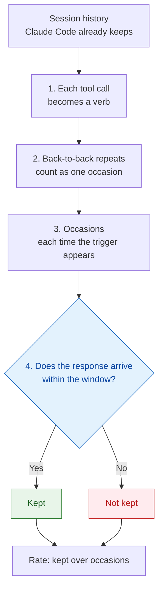

Versión en español: [README.md](README.md)

# adherencia-reglas

[](https://github.com/jleonceo/skill-adherencia-reglas/actions/workflows/ci.yml)

> This repository is the package you install as a Claude Code plugin. The method and the figures are in [adherencia-reglas](https://github.com/jleonceo/adherencia-reglas).

> **Read this first: the tool speaks Spanish, this page does not change that.** Nine of its ten
> flags, all its configuration keys, the literal values `antes` and `despues`, the fifteen action
> verbs and every line it prints are in Spanish. A rule written with English keys is rejected,
> loudly and in Spanish. This page is the reference for that vocabulary, not a localised program.
>
> The verbs: `git-commit` · `git-add` · `git-push` · `git-mirar` (inspect) · `test` · `shell` ·
> `leer-doc` (read a document) · `leer-codigo` (read code) · `escribir-doc` · `escribir-codigo` ·
> `buscar` (search) · `subagente` · `escribir-doctrina` · `leer-skill` · `leer-rag`. Direction takes
> `antes` or `despues`; the window is `ventana`, the start date `desde`, the scope `ambito` and the
> pass mark `umbral`.


## What it does



It counts occasions and responses.

One of your rules has a trigger (writing a document, closing a working day, touching a skill) and
an action that should follow it. The skill walks the session history Claude Code already keeps,
finds the triggers, checks whether the action came after, and returns the fraction. That is all it
does. It does not judge whether the rule is a good rule. It does not judge whether the work was any
good. It reads nothing that is not already on your disk. A 20 % may mean the rule gets ignored or
it may mean the rule is badly written: that reading is yours.

## Install

Three ways. The first is the short one and the last always works.

```bash
# 1. As a Claude Code plugin
/plugin marketplace add jleonceo/skill-adherencia-reglas
/plugin install adherencia-reglas@skill-adherencia-reglas

# 2. By copying the folder into your personal skills
git clone https://github.com/jleonceo/skill-adherencia-reglas
cp -r skill-adherencia-reglas/skills/adherencia-reglas ~/.claude/skills/

# 3. Without installing anything, running the script directly
python skills/adherencia-reglas/medir_adherencia.py
```

The example that ships in `ejemplo/` runs without any history of your own, which is what the output
block at the top of this page comes from:

```bash
python skills/adherencia-reglas/medir_adherencia.py \
  --sesiones ejemplo/historial --reglas ejemplo/reglas_ejemplo.json
```

The third way exists because the instrument does not need Claude Code. It is a standard library
script that reads `.jsonl` files. If all you want is the number, it hands it over without touching
your configuration.

## Usage

```bash
cd skills/adherencia-reglas
python medir_adherencia.py --sesiones "~/.claude/projects/MY-PROJECT"
```

Replace `MY-PROJECT` with your folder name. Look inside `~/.claude/projects`.

Keep the quotes. Claude Code builds that name from your working path and it can contain spaces.

With no arguments it measures every project at once.

These are the ten options, which is all of them:

| Option | What for |
|---|---|
| `--sesiones PATH` | which history to measure, one project or the root holding them |
| `--reglas FILE` | your rules, if you do not want the example ones |
| `--acciones` | which actions it recognised and in which files, to calibrate your vocabulary |
| `--por-dia N` | breaks down the last N days, because a global rate hides the bad day |
| `--curva-ventana` | how the rate moves with the window you allow the response |
| `--sensibilidad` | how much each arbitrary decision moves the figure, not just the window |
| `--respuesta-en-ambito` | demands the response land in the same scope as the trigger |
| `--sin-colapsar` | counts every write instead of every run of writes |
| `--subagentes` | includes subagent sessions, which are a different universe |
| `--json` | JSON output, to chain it into something else |

`--por-dia` takes a number: `--por-dia 7`. Without it the program stops and says so.

The two that most change the reading are `--curva-ventana` and `--sensibilidad`.

The first shows that the window you pick moves the figure as much as the behaviour you measure. The
second shows how much each decision someone made by eye while building the instrument moves it,
which is information almost no measuring tool publishes about itself.

Start with `--acciones`.

That view heads off the most expensive misunderstanding. The skill recognises actions by
vocabulary. Yours need not resemble anyone else's: if you say "exit gate" where the example says
"review", your rules will measure zero forever and that zero will look like non-compliance.
`--acciones` shows what it found and in which files, so you can tell at a glance whether the
problem is how you described the rule or the rule genuinely going unfollowed.

## Your rules

`reglas.json` ships with example rules so the first run returns something instead of a block of
zeroes. After that you edit it: each rule carries a trigger, an expected action and, optionally, a
scope that narrows it to certain folders.

Scope matters more than it looks. A rule that only applies to published text, measured across
everything you write, yields a dismal percentage that means nothing, because the denominator is
full of occasions where the rule never applied. This is not a theoretical warning: the first
version of this package published exactly such a figure on its own front page, inside the very
instrument built to catch that error, and an outside reader found it after ten in-house reviews
had not.

## What it does not do

It does not write. Not to your history, not to your configuration, not outside the folder it runs
from. `test_seguridad.py` plants fake sensitive-looking data (names, account numbers, keys) in a
toy history and demands that none of it surfaces through the aggregate views or through any error
path, on top of checking that nothing is written anywhere.

The exception is declared on purpose: `--acciones` shows paths from your history, because that is
what it is for.

## Uninstall

```bash
# if you installed it as a plugin: that is TWO commands, not one
/plugin uninstall adherencia-reglas@skill-adherencia-reglas
/plugin marketplace remove skill-adherencia-reglas

# if you copied the folder
rm -rf ~/.claude/skills/adherencia-reglas
```

The second command is the one almost nobody documents. Uninstalling the plugin drops it from the
plugin list, but leaves the marketplace registered and its local copy in the cache Claude Code keeps
at `~/.claude/plugins/cache`, which belongs to Claude Code and not to this skill.

Of the skill itself nothing is left, because it writes nothing: no database, no state file, no
configuration outside its own folder.

## Why trust it

**160 cases across three benches**, all on fabricated traces and never on real history, because a
bench that depends on today's data returns something else tomorrow.

And all three are mutation-verified, which is what separates a test bank from an ornament:

```bash
cd skills/adherencia-reglas
python mutar.py
```

That command sabotages the code on purpose, **15 sabotages**, and counts how many the bank catches.
Today it catches all 15 with no gaps. You do not have to take that on faith, you run it and watch.
The file under test is restored when it finishes and also if the process is killed halfway, because
the intact copy lives on disk and not in the program's memory; while that copy is still there,
`test_seguridad.py` goes red.

Some of those sabotages were written by someone who had not written the code, and they are exactly
the ones the in-house ones could not see. A mutator written by the author inherits the author's
blind spot.

A third instrument travels with the package, `cobertura.py`, which answers the question no reviewer
can answer by reading: which lines of the program no test case ever executes. It uses `trace`, from
the standard library, because nothing gets installed here.

## Requirements

Python 3.9 or newer, standard library, no network and nothing to install. On macOS and on most
Linux the interpreter is called `python3`, not `python`: the commands on this page say `python`
because they were written on Windows. That 3.9 is **certified** as of 27/07/2026: nine green jobs
across 3.9, 3.11 and 3.13 on Windows, Linux and Mac. Until that morning this line read «declared,
not certified». It was true when written and stopped being true on the first push, yet it stayed up
for hours. A note of humility goes stale like any other figure. This one went stale towards the side
that makes the package look worse than it is.

---

## Licence

MIT. See [LICENSE](LICENSE).
